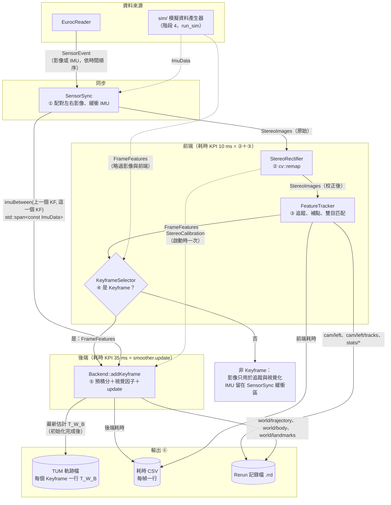
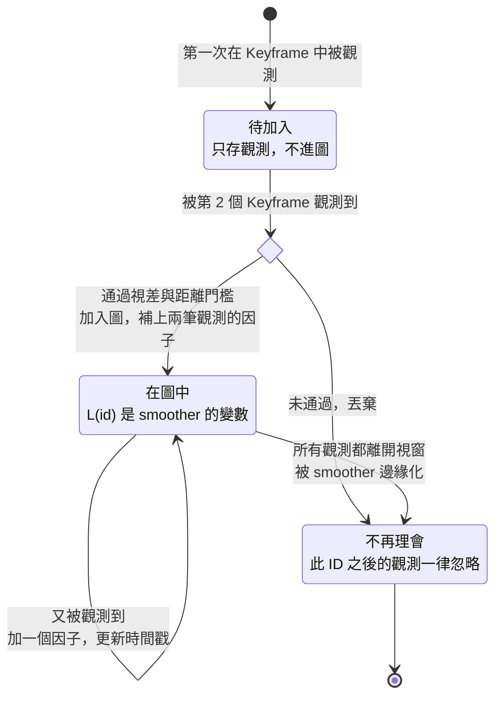

# Mini-VIO 系統設計

本文件說明 Mini-VIO 第一版的架構：模組切分、資料流、座標系、介面與後端的變數生命週期。需求見
[requirements.md](requirements.md)，目的、技術決定與分階段計畫見 [decisions.md](decisions.md)。

最後更新：2026-11-14

## 1. 設計原則

- 每個模組只做一件事，模組之間只用第 5 節的資料型別溝通，方便單獨測試，也方便在學習時一次只看一塊。
- 前端與後端的邊界是 `FrameFeatures`（每個特徵的 ID 與雙目量測）。階段 4 的模擬資料直接產生 `FrameFeatures`，略過影像與前端，
  後端程式完全不用改。
- 所有可調參數集中在一份 YAML 設定檔，程式中不寫死數值。
- 單一執行緒、依時間順序處理，結果可重現。

## 2. 座標系與符號

| 符號 | 座標系 | 說明 |
|---|---|---|
| `W` | 世界 | 重力對齊，Z 軸朝上。原點與 yaw 由初始化時的 Body 姿態決定 |
| `B` | Body | 即 IMU 座標系（EuRoC 的 `imu0/sensor.yaml` 中 `T_BS` 為單位矩陣） |
| `C0`、`C1` | 左、右相機 | 原始（未校正）相機座標系，外參為 sensor.yaml 中的 `T_BS` |
| `R` | 校正後的左相機 | 由 `cv::stereoRectify` 的旋轉 `R1` 定義：`p_R = R1 · p_C0` |

- 寫法 `T_A_B` 表示「B 座標系在 A 座標系下的姿態」，也就是把 B 座標系的點轉到 A：`p_A = T_A_B · p_B`。
  EuRoC 的 `T_BS` 依此即 `T_B_S`。
- 後端的姿態變數 `X_k` 是 `T_W_B`（Body 在世界座標系下的姿態），輸出的 TUM 軌跡也是 `T_W_B`。
- `GenericStereoFactor` 的 `body_P_sensor` 參數要給 `T_B_R = T_B_C0 · T_C0_R`，其中 `T_C0_R` 只有旋轉 `R1ᵀ`、沒有平移。
  **校正會讓左相機轉一個小角度**，忘記這個旋轉是最常見的錯誤之一，誤差小到不容易察覺，但會讓軌跡慢慢偏掉。
- 時間戳在程式內部一律用 `int64_t` 奈秒（與 EuRoC 相同）。交給 GTSAM 的 FixedLagSmoother 時，轉成「相對序列起點的秒數」`double`。

## 3. 資料流



實線是 `run_euroc` 的路徑，虛線是一次性的設定，或是階段 4 `run_sim` 取代 `EurocReader` 與前端的路徑。

每一幀的處理順序（`apps/run_euroc.cpp` 的主迴圈）：

1. `EurocReader` 依時間順序吐出下一組雙目影像，`SensorSync` 配對左右影像並緩衝 IMU。
2. `StereoRectifier` 對左右影像做去畸變與校正（`cv::remap`，對照表在啟動時算一次）。
3. `FeatureTracker` 追蹤並補點，輸出 `FrameFeatures`。
4. `KeyframeSelector` 判斷是否為 Keyframe。不是的話，這一幀的影像只用於前端追蹤與視覺化，不會變成後端的狀態；
   這段期間的 IMU 量測留在 `SensorSync` 的緩衝區中，不會丟棄。
5. 是 Keyframe 時，`SensorSync` 提供上一個 Keyframe 到這一個 Keyframe 之間的**全部** IMU 量測，連同 `FrameFeatures` 交給 `Backend`。
   後端把它們預積分成一個 `CombinedImuFactor`（理由見 11.1）。
6. 把 `Backend` 在此刻的最新估計值 `T_W_B` 寫入 TUM 軌跡檔，並記錄到 Rerun。動態初始化完成前（11.5）不輸出姿態。

前端的耗時 KPI（10 ms）包含步驟 2 和 3；後端的耗時 KPI（35 ms）是步驟 5 中 `IncrementalFixedLagSmoother::update` 的時間。

## 4. 目錄結構與分工

```
CMakeLists.txt
config/
  euroc.yaml                 所有參數
include/mini_vio/            標頭檔
src/                         mini_vio_core 函式庫（計入 2,000–3,000 行預算）
apps/
  run_euroc.cpp              主程式：命令列參數、主迴圈、輸出
  run_sim.cpp                階段 4：模擬資料上跑後端
sim/                         模擬資料產生器（不計入核心行數）
tests/                       GoogleTest 單元測試（dependencies_test.cpp 檢查容器內所有相依套件）
scripts/
  podman.sh                  容器操作
  build_and_test.sh          設定、編譯並執行全部測試
  eval_euroc.sh              對驗收序列跑 evo_ape，回報 ATE RMSE
```

| 模組 | 檔案 | 階段 | 撰寫者 | 預估行數 |
|---|---|---|---|---|
| 基本型別、設定檔讀取 | `types.hpp`、`config.hpp/.cpp` | 1 | Claude | 200 |
| `EurocReader`、`SensorSync` | `dataset.hpp/.cpp`、`sensor_sync.hpp/.cpp` | 1 | Claude | 300 |
| `StereoRectifier` | `rectifier.hpp/.cpp` | 1 | Claude | 120 |
| `FeatureTracker`（含偵測、KLT、外點剔除） | `frontend.hpp/.cpp` | 2 | 使用者 | 400 |
| `KeyframeSelector` | `keyframe.hpp/.cpp` | 2–3 | 使用者 | 80 |
| `Backend`（純視覺版） | `backend.hpp/.cpp` | 3 | 使用者 | 400 |
| `Backend` 加入 IMU、`StaticInitializer` | `backend.cpp`、`initializer.hpp/.cpp` | 4 | 使用者 | 300 |
| `DynamicInitializer`（視覺慣性對齊，用 Ceres 求解） | `initializer.hpp/.cpp` | 5 | 使用者 | 200 |
| 輸出：TUM、耗時統計、Rerun | `output.hpp/.cpp`、`viz.hpp/.cpp` | 1 起 | Claude | 300 |
| 模擬資料產生器 | `sim/` | 4 | Claude | — |
| 測試、評估腳本 | `tests/`、`scripts/` | 各階段 | Claude 建骨架，使用者補核心模組的測試 | — |

核心合計約 2,300 行，保留餘裕給除錯與 Rerun 視覺化。

## 5. 核心資料型別

只列出欄位，實際寫法以程式為準。

```cpp
using Timestamp = std::int64_t;               // 奈秒

struct ImuData {
    Timestamp t;
    Eigen::Vector3d gyro;                     // rad/s，B 座標系
    Eigen::Vector3d accel;                    // m/s²，比力（靜止時約為 +g 朝上）
};

struct StereoImages {
    Timestamp t;
    cv::Mat left, right;                      // 8 位元灰階；校正前或校正後由變數名稱區分
};

struct StereoMeasurement {
    FeatureId id;                             // 唯一、遞增，不重複使用
    double uL, uR, v;                         // 校正後的像素座標
};

struct FrameFeatures {
    Timestamp t;
    std::vector<StereoMeasurement> measurements;   // 只放雙目匹配成功的特徵
};

struct StereoCalibration {                    // StereoRectifier 的輸出，後端使用
    double fx, fy, cx, cy, baseline;          // 校正後的針孔模型
    gtsam::Pose3 T_B_R;                       // Body → 校正後左相機
};
```

左影像上追蹤成功、但右影像匹配失敗的特徵，前端繼續追蹤，只是那一幀不放進 `measurements`。

## 6. 介面（C++20 Concepts）

```cpp
template <typename R>
concept DatasetReader = requires(R r) {
    { r.next() } -> std::same_as<std::optional<SensorEvent>>;   // 依時間順序的影像或 IMU
    { r.cameraCalibration() } -> std::same_as<RawStereoCalibration>;
    { r.imuNoise() } -> std::same_as<ImuNoiseParams>;
};

template <typename T>
concept Tracker = requires(T t, const cv::Mat& left, const cv::Mat& right, Timestamp ts) {
    { t.track(ts, left, right) } -> std::same_as<FrameFeatures>;
};
```

`FeatureDetector` 的 Concept 也照同樣方式定義（輸入影像與既有特徵位置，輸出新特徵點）。第一版每個 Concept 只有一種實作，
主程式以樣板參數接收，不用 virtual 函式。

`SensorSync` 對外提供：

```cpp
std::span<const ImuData> imuBetween(Timestamp t0, Timestamp t1);
```

回傳的區間第一筆與最後一筆分別內插到 `t0`、`t1`，因此不能直接指向原始緩衝區。做法是 `SensorSync` 內部維護一個
`std::vector<ImuData>` 工作區，每次組好區間後回傳指向它的 span；span 只在下一次呼叫前有效。`t0` 之前的原始資料會被丟棄，
緩衝區不會無限長大。

## 7. 雙目校正（階段 1）

1. 由 sensor.yaml 算出 `T_C1_C0 = T_B_C1⁻¹ · T_B_C0`，傳給 `cv::stereoRectify`（`CALIB_ZERO_DISPARITY`、`alpha = 0`，
   只保留沒有黑邊的區域）。
2. 由輸出的 `P1`、`P2` 取得 `fx = P1(0,0)`、`fy = P1(1,1)`、`cx`、`cy`、`baseline = −P2(0,3) / fx`，建立
   `gtsam::Cal3_S2Stereo(fx, fy, 0, cx, cy, baseline)`。
3. 用 `cv::initUndistortRectifyMap` 預先算好左右的對照表，每幀只做 `cv::remap`。
4. 驗證：在 Rerun 中把校正後的左右影像並排，畫幾條水平線，同一個物體的角點應落在同一列。EuRoC 的基線約 11 cm。

## 8. 前端（階段 2）

要做的事列在 FR-3，這裡只定下與其他模組相關的決定，演算法細節由使用者實作時決定：

- 全部在**校正後**的影像上做，輸出的座標不需要再轉換。
- 每幀的步驟：左影像 KLT 時間追蹤 → 前後向一致性檢查 → 對前一幀與這一幀的對應點做基礎矩陣 RANSAC → 在空的網格中補新特徵 →
  左右影像 KLT 雙目匹配 → 極線檢查（`|vL − vR|` 小於門檻）與視差必須為正。
- 特徵 ID 由 `FeatureTracker` 產生，全域遞增，消失後不再重複使用。後端用它當作 Landmark 的鍵值。

## 9. 關鍵幀選擇

FR-4 的三個條件都是設定檔參數：平均視差、追蹤中的特徵數、與上一個 Keyframe 的最長間隔。平均視差的計算只用與上一個
Keyframe 共同追蹤到的特徵。目標是 3–5 Hz，可以在 Rerun 上畫出 Keyframe 的時間點來調整門檻。

## 10. 後端

### 10.1 變數與鍵值

| 變數 | GTSAM 鍵值 | 說明 |
|---|---|---|
| 姿態 `T_W_B` | `X(k)` | `k` 是 Keyframe 序號 |
| 速度 | `V(k)` | 階段 4 起 |
| IMU Bias | `B(k)` | 階段 4 起 |
| Landmark（世界座標） | `L(id)` | `id` 即前端的特徵 ID |

每個鍵值都要在 `KeyTimestampMap` 中給時間戳。姿態、速度、Bias 用該 Keyframe 的時間；**Landmark 的時間戳每次被觀測時都要更新成
最新一次觀測的時間**（`FixedLagSmoother::update` 會覆寫既有鍵值的時間戳）。這樣 Landmark 會在最後一個觀測它的 Keyframe 離開視窗時，
才跟著一起被邊緣化，符合 FR-7「不得殘留在圖中」的要求。

### 10.2 Landmark 的生命週期



- 初始值：用**較早那個 Keyframe**（已被優化過）的估計姿態，加上它的雙目量測三角化。新 Keyframe 的姿態還只是預測值，
  不適合拿來三角化。
- 被邊緣化的 ID 若又被前端追蹤到，直接忽略。可以順便統計這種情況的次數，數量多代表視窗太短。
- 因雙目單次觀測就能決定 3D 位置，Landmark 在只剩一筆觀測時也不會奇異。這是選擇雙目的主要好處之一，第 3 階段的投影片會說明。

### 10.3 因子

| 因子 | 階段 | 說明 |
|---|---|---|
| `PriorFactor<Pose3>` on `X(0)` | 3 | 固定整個問題的參考座標系（6 自由度） |
| `GenericStereoFactor<Pose3, Point3>` + Huber | 3 | 每筆觀測一個，`body_P_sensor = T_B_R` |
| `PriorFactor` on `V(0)`、`B(0)` | 4 | 來自初始化（階段 4 靜止、階段 5 動態） |
| `CombinedImuFactor` | 4 | 相鄰 Keyframe 之間 |

### 10.4 新 Keyframe 的姿態初始值

- 第一個 Keyframe：單位姿態（階段 3），或初始化給出的姿態（階段 4 起）。
- 階段 3，以及階段 5 動態初始化完成前（純視覺模式）：**Keyframe 對 Keyframe 的雙目 PnP**，不使用圖中的 Landmark。
  1. 3D 點：上一個 Keyframe 中雙目匹配成功的特徵，直接以視差三角化，表示在上一個 Keyframe 的校正左相機座標系：
     `Z = fx · baseline / (uL − uR)`、`X = (uL − cx) · Z / fx`、`Y = (v − cy) · Z / fy`。
     視差小於 `backend.min_disparity_px` 的點不用。
  2. 2D 點：同一個特徵 ID 在這一幀左影像的 `(uL, v)`。KLT 追蹤本身帶著 ID，不需要另外匹配。
  3. `cv::solvePnPRansac` 求相對姿態。它回傳的 `rvec`、`tvec` 是把點從上一個 Keyframe 的相機座標系轉到這一幀的相機座標系，
     也就是 `T_{R,k}_{R,k−1}`，**要先取反矩陣**才是 `T_{R,k−1}_{R,k}`。
  4. 接在上一個 Keyframe 已優化的姿態後面：`T_W_Bk = T_W_Bk−1 · T_B_R · T_{R,k−1}_{R,k} · T_B_R⁻¹`。
  5. 內點數少於 `backend.pnp.min_inliers` 時，退回等速模型（沿用前兩個 Keyframe 之間的相對運動）。
- 選這個做法而不用視窗內 Landmark 的理由：
  - Landmark 要被 2 個 Keyframe 觀測後才進圖，第 1、2 個 Keyframe 和追丟恢復後的一段時間，圖中沒有可用的點；雙目單一幀就有深度，沒有這個問題。
  - 只依賴前端的 `FrameFeatures` 與上一個 Keyframe 的姿態，不需要把後端的 Landmark 估計值傳回來，可以單獨測試。
  - 單次雙目觀測的深度誤差較大，但這只是初始值，後端優化會修正。
- PnP 的內點比例也當作前端品質的指標，畫在 Rerun 上（`stats/pnp_inlier_ratio`）。
- 階段 4 起（初始化完成後）：用 IMU 預積分，從上一個 Keyframe 的 `NavState` 與 Bias 預測（`PreintegratedCombinedMeasurements::predict`）。
  前端追丟期間（11.6）也是同一個做法。

### 10.5 每個 Keyframe 的更新流程

1. 建立新的 `NonlinearFactorGraph`、`Values`、`KeyTimestampMap`。
2. 加入新 Keyframe 的變數與初始值（10.4）。
3. 階段 4 起：對 IMU 區間做預積分，加入 `CombinedImuFactor`。
4. 處理這一幀的每筆 `StereoMeasurement`（10.2）。
5. 呼叫 `smoother.update(...)`，計時。
6. 從 `smoother.calculateEstimate()` 取出最新的 `X(k)`，交給輸出模組；
   階段 4 起一併取出 `V(k)`、`B(k)` 作為下一次預積分的起點。

## 11. IMU 與初始化（階段 4–5）

### 11.1 為什麼只有 Keyframe 是狀態

每一筆 IMU 量測都會用上，只是相鄰 Keyframe 之間的量測（0.2–0.3 秒，約 40–60 筆）先預積分成一個相對運動量（ΔR、Δv、Δp），
雜訊也一路傳遞成它的協方差。一個預積分因子與「每幀一個因子串成鏈」提供的約束幾乎等價，差別只在兩處近似：區間內 Bias 視為常數
（Bias 改變時以一階近似修正），以及線性化點不同。區間短時這兩項都很小；`keyframe.max_interval_s` 限制區間長度，
也是為了避免預積分誤差隨時間累積（位置誤差約與時間的三次方成正比）。

把每一幀都變成狀態，多出來的資訊主要來自視覺，而且效益有限：

- 相鄰幀只差幾公分，觀測高度重複，對幾何的約束增加很少。
- 相鄰幀的 KLT 追蹤誤差高度相關，但因子圖假設觀測互相獨立，觀測越密越會過度自信。
- 3 秒視窗的狀態會從 10–15 個變成約 60 個（每個 15 維），視覺因子多出 4–5 倍，後端耗時 KPI 難以達成。

這個取捨在階段 5 用實驗驗證（第 17 節）。

### 11.2 IMU 在每一幀的用途（選配）

以下兩種用法讓 IMU 在每一幀都發揮作用，但不增加後端的狀態：

- **高頻率姿態輸出**：從最新 Keyframe 的 `NavState` 與 Bias，用 IMU 往前推（`PreintegratedCombinedMeasurements::predict`），
  得到每一幀甚至每一筆 IMU 時刻的姿態。評分仍依 FR-8 使用 Keyframe 當下的估計值，這個輸出用於視覺化，或日後給控制使用。
- **前端旋轉預測**：用陀螺儀積分兩幀之間的旋轉，預測特徵在新影像中的位置，當作 KLT 的初始值，提升快速轉動時的追蹤穩定度。
  這會讓前端依賴 IMU。原本放在階段 5 之後，但 MH_01_easy 開頭的劇烈晃動可能讓 KLT 大量追丟，因此改為階段 5 的候選：
  先量測開頭晃動段的追蹤成功率，不夠再加入。陀螺儀 Bias 在初始化前未知，但 EuRoC 的 Bias 約 0.08 rad/s，
  一幀（50 ms）只造成約 0.004 rad 的誤差，直接用原始陀螺儀讀值預測就夠了。

### 11.3 IMU 參數

- `PreintegrationCombinedParams::MakeSharedU(g)`（世界座標 Z 朝上）。EuRoC sensor.yaml 給的是連續時間的雜訊密度，
  協方差就是密度的平方，GTSAM 會依取樣間隔自行離散化。真實資料通常需要把雜訊放大數倍，倍率放在設定檔中。

### 11.4 靜止初始化（階段 4，模擬資料）

- 在序列開頭的滑動視窗中找加速度計變異低於門檻、持續約 1 秒的區段。
  - 求旋轉 `R_W_B`，使 `R_W_B · mean(accel)` 指向 `+Z`；yaw 設為 0。
  - 陀螺儀 Bias 的初始值為陀螺儀平均值，加速度計 Bias 初始值為 0，速度為 0。
  - 找不到就回報錯誤並結束。
- 只用在模擬資料。目的是先在最單純的情況下把 IMU 的座標系、正負號與 Prior 弄對，再進入 11.5。

### 11.5 動態初始化（階段 5，EuRoC）

EuRoC 不設起始時間，從第一筆資料開始跑。MH_01_easy 前約 21 秒都在手持移動（0–6 秒加速度標準差達 1.2–1.6 m/s²），
所以初始化必須在移動中完成。雙目讓這件事變簡單：視覺已經給出真實尺度的姿態，剩下的未知數只有重力方向、速度與陀螺儀 Bias，
而且都能用線性最小平方解。

**初始化前**：`Backend` 以階段 3 的純視覺模式執行，`X(0)` 的 Prior 設為單位姿態，因此姿態都表示在第一個 Keyframe 的座標系
（記為 `c0`），不是重力對齊的 `W`。同時保存相鄰 Keyframe 之間的 IMU 區間。前端追丟時（判定方式同 11.6），清空並重新開始累積。
PnP 內點不足只會讓這個 Keyframe 的初始值退回等速模型，不會清空。

**累積到 N 個 Keyframe 時嘗試對齊**（`init.min_keyframes`，約 1–2 秒）：

1. **陀螺儀 Bias**：相鄰 Keyframe 的視覺相對旋轉 `R_iᵀ R_j` 應等於預積分的 `ΔR_ij(b_g)`。用預積分對 `b_g` 的 Jacobian
   （GTSAM 的 `delRdelBiasOmega`）線性化，解 3 個未知數的最小平方。解出後以新的 Bias 重新預積分。
2. **重力與速度**：在 `c0` 座標系中，預積分給出
   `v_j = v_i + g·Δt_ij + R_i·Δv_ij`、`p_j = p_i + v_i·Δt_ij + ½·g·Δt_ij² + R_i·Δp_ij`。
   `R_i`、`p_i` 來自視覺，未知數是每個 Keyframe 的 `v_k` 與重力向量 `g`（共 3N + 3 個），每對相鄰 Keyframe 提供 6 個線性方程式。
   單目在這一步還要多解一個尺度，雙目不用。
3. **檢查**：`|‖g‖ − 9.81|` 與方程式殘差都要低於門檻（`init.max_gravity_err`、`init.max_residual`）。
   不通過就捨棄最舊的 Keyframe，等下一個 Keyframe 再試。
4. **固定重力大小再解一次**：把 `g` 換成同方向、大小 9.81 的向量，只解速度。
5. **轉到 `W`**：求旋轉 `R_W_c0` 使 `R_W_c0 · g` 指向 `−Z`，yaw 取最小旋轉。姿態、速度、Landmark 全部乘上這個旋轉。
6. **交給 VIO 後端**：建立新的 `IncrementalFixedLagSmoother`，把初始化視窗內的 Keyframe、Landmark、`CombinedImuFactor` 與
   雙目因子一次放進去，並在最舊的 Keyframe 上加 `X`、`V`、`B` 的 Prior。純視覺的 smoother 丟棄。
   這一次 update 不計入後端耗時 KPI。

- **求解工具：Ceres Solver**。步驟 1、2、4 的最小平方都寫成 Ceres 的殘差，用 `AutoDiffCostFunction` 由自動微分算 Jacobian。
  - 步驟 1 可以直接用非線性殘差 `Log((ΔR_ij · Exp(J_bg · δb_g))ᵀ · R_iᵀ · R_j)`，不必手動線性化。殘差函式是樣板，
    旋轉運算要用 `ceres/rotation.h` 的函式（例如 `AngleAxisToRotationMatrix`），才能接受自動微分的 `Jet` 型別。
    `ΔR_ij` 與 `J_bg` 從 GTSAM 的預積分物件取出，當作常數傳進殘差。
  - 步驟 2 是線性問題，Ceres 一次迭代就收斂，結果與 Eigen 直接解相同。
  - 步驟 4 可以把 `g` 放在 `ceres::SphereManifold<3>` 上，初始值設為大小 9.81，直接在「大小固定」的限制下同時解重力方向與速度，
    取代「先解再固定大小重解」的兩步。
  - Ceres 只用在初始化，滑動視窗後端仍然是 GTSAM。
- 加速度計 Bias 初始值為 0：視窗只有 1–2 秒時，它幾乎無法與重力方向分開，交給之後的 smoother 慢慢估計。
- 靜止開機時，`Δp` 與速度都是 0，`Δv` 的方程式仍能解出重力，所以靜止是這個方法的特例，不需要另外處理。
- 完成初始化的時間（相對序列第一筆資料的秒數）印在結果中，也畫到 Rerun，用來評估開頭晃動對系統的影響。

### 11.6 初始化後前端追丟（階段 5）

初始化完成後，前端追丟時**不重新初始化**，而是靠 IMU 推算姿態，等前端恢復。

- **判定追丟**：這一幀的雙目量測中，對應到圖中 Landmark 的數量少於 `tracking_loss.min_features`。
- **追丟期間**：
  - 仍依 `keyframe.max_interval_s` 建立 Keyframe，相鄰 Keyframe 之間照常加入 `CombinedImuFactor`。
    新 Keyframe 的 `X`、`V`、`B` 完全由 IMU 因子從前一個 Keyframe 決定，圖不會奇異，只是不確定性隨時間變大。
  - 「追蹤中的特徵數低於門檻」這個 Keyframe 條件在追丟期間停用，否則每一幀都會變成 Keyframe，
    視窗內的狀態數暴增，後端耗時 KPI 無法達成。
  - 仍照常輸出姿態（IMU 推算的值），軌跡不中斷。
- **前端恢復**：前端補點後新出現的特徵，照 10.2 的流程變成 Landmark。三角化用到的較早 Keyframe 姿態是 IMU 推算的，
  誤差較大，但之後的雙目觀測會把它和 Landmark 一起修正回來。
- **紀錄**：追丟的次數、每次的持續時間與期間的 ATE，畫到 Rerun（`stats/tracking_lost`），作為 IMU 推算能撐多久的實驗資料。
- **追丟太久**：IMU 推算的位置誤差約與時間的三次方成正比。追丟超過 `tracking_loss.max_imu_only_s` 時，
  第一版回到初始化前的狀態重新初始化，避免帶著已經發散的狀態繼續跑。


## 12. 模擬資料（階段 4）

`sim/` 產生已知真值的資料，讓 IMU 的座標系與正負號錯誤無所遁形：

- 一條平滑的 6 自由度軌跡（例如繞著場景的螺旋），解析式求導得到角速度與比力，再依 sensor.yaml 的雜訊參數加雜訊與 Bias 漂移。
- 場景中隨機撒 3D 點，依 EuRoC 的校正後內參與 `T_B_R` 投影，產生 `FrameFeatures`（可設定像素雜訊與外點比例）。
- 開頭可選擇靜止 2 秒（測試 11.4 的靜止初始化），或一開始就在移動（測試 11.5 的動態初始化，可與真值比對解出的重力方向、速度與 Bias）。
- 輸出真值軌跡（TUM 格式），用同一套 evo 評估。

`apps/run_sim.cpp` 與 `run_euroc.cpp` 共用 `Backend`、`KeyframeSelector`、輸出模組，只是資料來源不同。

## 13. 設定檔

```yaml
dataset:
  start_offset_s: 0.0         # 僅供除錯（FR-1），驗收時必須為 0
  duration_s: -1              # -1 表示跑到序列結束

frontend:
  max_features: 150
  grid: { rows: 4, cols: 6 }
  klt: { window: 21, pyramid_levels: 3 }
  fb_check_max_px: 1.0
  ransac_threshold_px: 1.0
  epipolar_max_dv_px: 2.0

keyframe:
  min_mean_parallax_px: 15.0
  min_tracked_features: 60
  max_interval_s: 0.3

backend:
  window_s: 3.0
  stereo_sigma_px: 1.0
  huber_k: 1.345
  min_disparity_px: 2.0
  max_depth_m: 30.0
  prior_pose_sigma: { rot_rad: 1.0e-3, pos_m: 1.0e-3 }
  pnp: { ransac_threshold_px: 2.0, min_inliers: 20 }   # 10.4

imu:
  gravity: 9.81
  noise_scale: 5.0            # 乘在 sensor.yaml 的雜訊密度上

init:
  method: dynamic             # dynamic（EuRoC）或 static（模擬資料）
  static: { window_s: 1.0, max_accel_std: 0.05 }
  min_keyframes: 6
  max_gravity_err: 0.3        # m/s²，|‖g‖ − 9.81| 的上限
  max_residual: 0.1           # 對齊殘差 RMS 的上限

tracking_loss:                # 11.6
  min_features: 15            # 對應到圖中 Landmark 的雙目量測少於此數即視為追丟
  max_imu_only_s: 2.0         # 只靠 IMU 推算超過此時間就重新初始化

output:
  rerun: true
```

以上數值是起始值，各階段調參後更新。

## 14. 輸出與評估

- 軌跡：TUM 格式，每個 Keyframe 一行，`timestamp[s] tx ty tz qx qy qz qw`，內容為 `T_W_B`。
- 耗時：CSV，每幀一行，欄位為時間戳、前端耗時、是否為 Keyframe、後端耗時。主程式結束時印出平均、中位數與 95 百分位數，
  以及動態初始化完成的時間。
- 評估：`scripts/eval_euroc.sh` 執行
  `evo_ape euroc <mav0/state_groundtruth_estimate0/data.csv> <traj.tum> -a`（SE(3) 對齊，雙目不需要估計尺度），回報 ATE RMSE。
- Rerun 實體（entity）路徑，時間軸使用資料集時間戳：

| 路徑 | 型別 | 內容 |
|---|---|---|
| `cam/left` | `Image` | 校正後的左影像 |
| `cam/left/tracks` | `LineStrips2D` | 特徵最近幾幀的追蹤軌跡，以 ID 上色 |
| `world/trajectory` | `LineStrips3D` | Keyframe 估計軌跡 |
| `world/body` | `Transform3D` | 目前的 `T_W_B` |
| `world/landmarks` | `Points3D` | 視窗內的 Landmark |
| `world/groundtruth` | `LineStrips3D` | 真值（僅供肉眼比對，未對齊） |
| `stats/*` | `Scalars` | 特徵數、內點比例、前後端耗時、初始化狀態、是否追丟 |

## 15. 測試

- 框架：GoogleTest（容器內的 `libgtest-dev`），以 `ctest` 執行。
- 一行指令（KPI 的工程品質項目）：`scripts/podman.sh run scripts/build_and_test.sh`。
- 優先寫測試的地方，都是錯了也不容易從軌跡看出來的部分：
  - `SensorSync`：區間端點內插、空區間、跨越多筆資料。
  - `StereoRectifier`：把已知 3D 點投影到原始左右影像，校正後 `v` 相同、視差符合 `fx · baseline / Z`。
  - 座標轉換：`T_B_R` 的組合方式。
  - 10.4 的雙目 PnP：用已知相對姿態的兩幀模擬觀測，確認解出的相對姿態方向正確（沒有忘記取反矩陣），且旋轉 30° 時仍正確。
  - 後端：在模擬資料上，加入 10% 外點，開啟 Huber 時 ATE 明顯小於關閉時。
  - 動態初始化：在一開始就移動的模擬資料上，解出的重力方向、速度與陀螺儀 Bias 接近真值；靜止開始時也能成功。

## 16. 已知風險

| 風險 | 影響 | 對策 |
|---|---|---|
| `IncrementalFixedLagSmoother` 邊緣化時丟出 `IndeterminantLinearSystemException` | 程式中止 | 檢查是否有只連到單一變數的 Landmark、Prior 是否正確；必要時暫時換成 `BatchFixedLagSmoother` 比對 |
| 漏掉 `T_C0_R` 的校正旋轉 | 軌跡慢慢偏移 | 第 15 節的單元測試 |
| PnP 結果忘記取反矩陣 | 直線時看似正常，轉彎時姿態初始值完全錯誤，優化可能不收斂 | 第 15 節的單元測試 |
| MH_01_easy 開頭約 21 秒的手持移動 | 動態初始化遲遲無法通過檢查，或 KLT 大量追丟 | 對齊失敗時捨棄最舊 Keyframe 重試；必要時加入 11.2 的陀螺儀旋轉預測 |
| 初始化後又追丟（例如劇烈晃動、影像模糊） | 只靠 IMU 推算，誤差隨時間快速累積 | 11.6：IMU 推算等前端恢復；超過 `max_imu_only_s` 才重新初始化 |
| 遠處、視差極小的點 | 深度不確定性大，拉偏姿態 | 最小視差與最大距離門檻 |
| Huber 只能減輕、不能完全消除外點 | 少數錯誤匹配仍有影響 | 前端的 RANSAC 與極線檢查仍是第一道防線 |

## 17. 待決事項

- 動態初始化的門檻（`min_keyframes`、`max_gravity_err`、`max_residual`）：先在模擬資料上決定，再用 MH_01_easy 調整。
- `tracking_loss.max_imu_only_s` 的值：可以在模擬資料上中途停用視覺，量測 IMU 推算的誤差隨時間的增長來決定。
- V1_01_easy 目前只有內層的 `V1_01_easy.zip`，尚未解壓縮出 `mav0/`。
- 階段 5 的實驗候選：把 Keyframe 條件改成「每一幀都是 Keyframe」，比較 ATE 與後端耗時，驗證 11.1 的取捨。
  預期 ATE 只小幅改善或因過度自信而變差，後端耗時明顯增加。
- 是否實作 11.2 的高頻率姿態輸出。前端旋轉預測改由階段 5 的開頭晃動段追蹤成功率決定。
